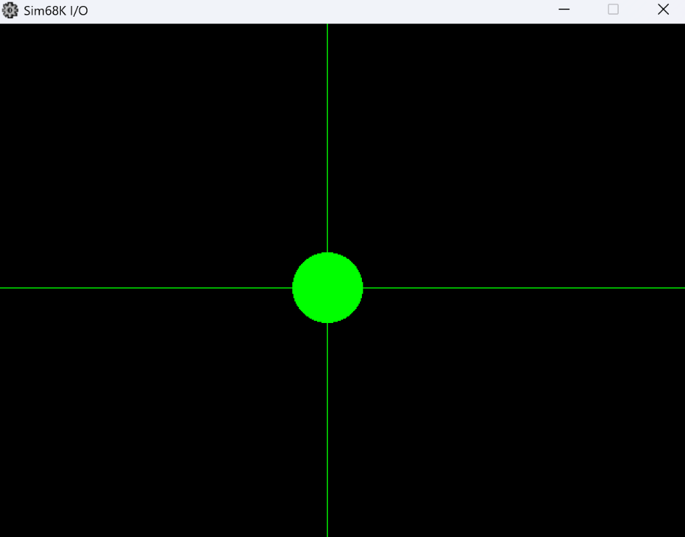
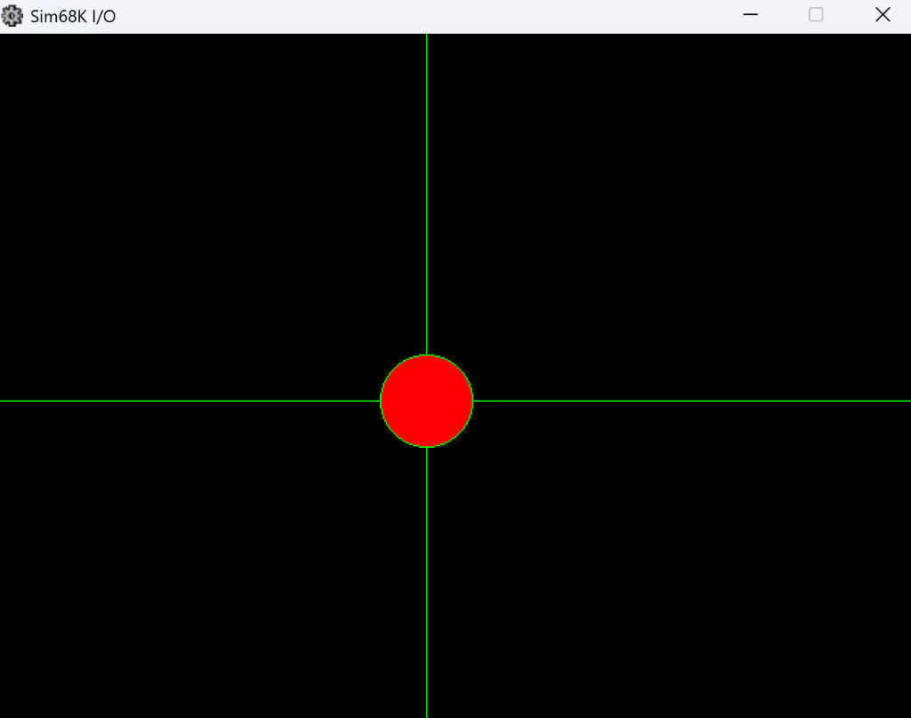

<p align="right">
  <strong>Idioma:</strong>
  <a href="README.md">English</a> | <b>Español</b>
</p>

# Control de Periféricos e Interrupciones en Ensamblador MC68000

<p align="center">
  
  
  
  
  
</p>

Solución de programación a bajo nivel para la práctica de control de periféricos con soporte del sistema e interrupciones en la asignatura **Estructura de Computadores II** del Grado en Ingeniería Informática en la **Universitat de les Illes Balears (UIB)**.

El proyecto está implementado en lenguaje ensamblador del microprocesador **Motorola 68000 (MC68000)** y ejecutado sobre el entorno de simulación [EASy68K](http://www.easy68k.com/).

---

## Descripción del Sistema

La aplicación gestiona un entorno interactivo en tiempo real sobre la ventana de salida gráfica (640 &times; 480 px), donde un círculo vectorial responde de forma continua al movimiento y las acciones del ratón:

- **Seguimiento Continuo del Cursor**: El centro geométrico del círculo ($r = 32\ \text{px}$) se sincroniza dinámicamente con las coordenadas cartesianas $(X, Y)$ reportadas por el periférico del ratón.
- **Detección de Estado del Botón (Clic)**:
  - **Reposo (sin pulsar)**: Relleno y contorno en color verde (`#00FF00`).
  - **Pulsado (clic izquierdo activo)**: Relleno en color rojo (`#0000FF` en formato BGR) con contorno verde.
- **Detección de Colisiones & Audio**: Detección de colisión del radio del círculo con los 4 límites de la pantalla (superior, inferior, izquierdo, derecho), activando señales acústicas asociadas al rebote y a la interacción con el botón.

---

## Arquitectura de E/S e Interrupciones

| Mecanismo / Periférico | Identificador | Función en la Práctica |
| :--- | :---: | :--- |
| **Interrupción de Ratón** | `INTRDMOU EQU 7` | Interrupción de nivel 7 para muestreo y captura de posición/estado del cursor. |
| **Doble Búfer Gráfico** | `TRNUPDBF EQU 1` | Llamada al sistema (TRAP 1) para actualización atómica del búfer gráfico y eliminación de parpadeo (*flicker*). |
| **Dibujado Vectorial** | `TRNPLGFX EQU 2` | Llamada al sistema (TRAP 2) para el trazado del círculo con radio y color dinámicos. |
| **Resolución de Pantalla** | `640 × 480 px` | Coordenadas gestionadas mediante constantes `SCRWIDTH` y `SCRHEIGH`. |

---

## Demostración Gráfica

| Estado Normal (Sin Clic) | Estado Activo (Con Clic Izquierdo) |
| :---: | :---: |
|  |  |

El repositorio incluye además una grabación en vídeo (`PRAC2B.mp4`) que ilustra el comportamiento en tiempo real, la fluidez del refresco de pantalla y los efectos de sonido.

---

## Estructura de Archivos

```text
├── PRAC2B.X68       # Archivo principal: constantes de hardware, inicialización y bucle de despacho
├── SUBRTN.X68       # Subrutinas: cálculo de colisiones, rutinas de servicio (ISR), dibujado y audio
├── PRAC2B.mp4       # Demostración en vídeo del funcionamiento interactivo
├── sin_click.png    # Captura de pantalla en estado de reposo
├── con_click.png    # Captura de pantalla con evento de clic activo
└── LICENSE          # Licencia MIT
```

---

## Requisitos y Ejecución

1. Descargar e instalar el simulador **[EASy68K](http://www.easy68k.com/)** (entorno de desarrollo y ejecución de ensamblador Motorola 68000 para Windows / Wine).
2. Abrir el editor de código **EDIT68** y cargar el archivo fuente `PRAC2B.X68`.
3. Pulsar **Assemble (F9)** para compilar y generar el archivo binario ejecutable (`.S68`).
4. Abrir el simulador **SIM68 (F8)** y ejecutar el programa con **Run (F5)**.
5. Interactuar con el ratón sobre la ventana gráfica de E/S para verificar el seguimiento del cursor, el cambio de color y los sonidos de rebote.

---

<p align="center">
  <sub>Estructura de Computadores II &middot; Universitat de les Illes Balears (UIB)</sub>
</p>
