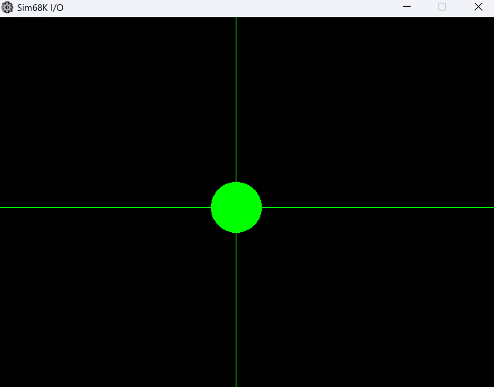
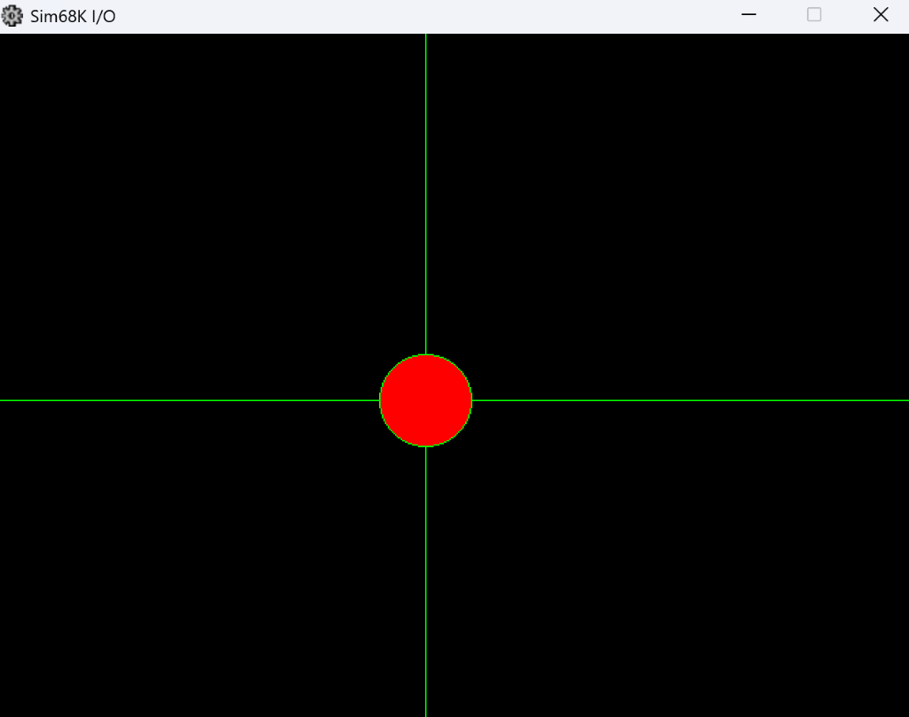

<p align="right">
  <strong>Language:</strong>
  <b>English</b> | <a href="README.es.md">Español</a>
</p>

# Peripheral Control and Interrupts in MC68000 Assembly

<p align="center">
  
  
  
  
  
</p>

Low-level assembly engineering project covering system-supported peripheral access and hardware interrupts in the **Computer Architecture & Structure II** course of the Computer Engineering degree at **Universitat de les Illes Balears (UIB)**.

The project is implemented in **Motorola 68000 (MC68000)** assembly language and executed on the [EASy68K](http://www.easy68k.com/) simulation platform.

---

## System Overview

The program drives a real-time interactive loop on the simulated graphical I/O display ($640 \times 480\ \text{px}$), where a vector circle responds continuously to user mouse movement and button events:

- **Continuous Cursor Tracking**: The geometric center of the circle ($r = 32\ \text{px}$) dynamically tracks the Cartesian coordinates $(X, Y)$ reported by the mouse peripheral.
- **Button State Detection (Click)**:
  - **Resting state (unclicked)**: Fill and border rendered in green (`#00FF00`).
  - **Active state (left click pressed)**: Fill rendered in red (`#0000FF` in BGR format) with green border.
- **Collision Detection & Audio Feedback**: Real-time bounding collision detection against all four display boundaries (top, bottom, left, right), triggering acoustic sound signals on rebound and mouse click events.

---

## I/O & Interrupt Architecture

| Peripheral / Mechanism | Identifier | Role in Implementation |
| :--- | :---: | :--- |
| **Mouse Interrupt** | `INTRDMOU EQU 7` | Level 7 interrupt handling mouse packet sampling, position reporting, and click state capture. |
| **Double Buffering** | `TRNUPDBF EQU 1` | System call (TRAP 1) for atomic video buffer flip, eliminating visual flicker. |
| **Vector Drawing** | `TRNPLGFX EQU 2` | System call (TRAP 2) for plotting the circle with dynamic radius and color. |
| **Screen Resolution** | `640 × 480 px` | Coordinate geometry governed by `SCRWIDTH` and `SCRHEIGH` hardware constants. |

---

## Graphical Demonstration

| Resting State (No Click) | Active State (Left Click Pressed) |
| :---: | :---: |
|  |  |

The repository also includes a video recording (`PRAC2B.mp4`) demonstrating real-time interaction, screen refresh rate, and acoustic feedback.

---

## File Structure

```text
├── PRAC2B.X68       # Main entry point: hardware constants, initialization, and dispatch loop
├── SUBRTN.X68       # Subroutines: collision math, interrupt service routines (ISR), drawing, and audio
├── PRAC2B.mp4       # Video demonstration of real-time execution
├── sin_click.png    # Screen capture in resting state
├── con_click.png    # Screen capture during active mouse click
└── LICENSE          # MIT License
```

---

## Requirements & Execution

1. Download and install the **[EASy68K](http://www.easy68k.com/)** simulator suite (Motorola 68000 development and execution environment for Windows / Wine).
2. Open the code editor **EDIT68** and load the main source file `PRAC2B.X68`.
3. Press **Assemble (F9)** to compile and generate the executable binary (`.S68`).
4. Launch the simulator **SIM68 (F8)** and execute the program with **Run (F5)**.
5. Interact with the graphical I/O display using your mouse to verify cursor tracking, color transitions, and boundary rebound sounds.

---

<p align="center">
  <sub>Computer Structure II | Universitat de les Illes Balears (UIB)</sub>
</p>
